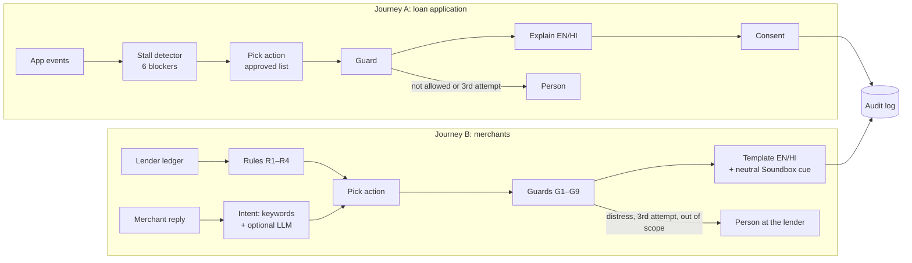

# Pakka ✦ — Hackathon Presentation Guide

**Team Queen** · Samina Parveen · Madhur Tandon · Aditya Karn
**Paytm Build for India AI Hackathon (Delhi, 31 Oct 2026)** · Track 2: AI-Powered Financial Journeys

> **One line:** Pakka notices when someone is stuck or slipping in a financial journey, tells them what's wrong in their own language, offers a fix they agree to, and hands them to a person when it can't help. It never decides anything about the loan.

```
spot it  →  explain it  →  fix it (with consent)  →  check it worked  →  hand off to a person if not
```

**One engine, two journeys:**

| Journey | Who it helps | Live demo |
|---|---|---|
| **A. Loan application rescue** | People stuck while applying for a personal loan: KYC photo failures, face check, DigiLocker, confusing loan terms, timeouts | `/demo` (`/demo?tour=1` plays itself) |
| **B. Pakka for Merchants** | Shop owners repaying a merchant loan through daily deductions from their sales (EDI), who fall short on a slow day | `/merchant` (`/merchant?tour=1` plays itself) |

> Prototype on synthetic data only. Not connected to Paytm or any lender.

---

## 1. The problem

**Loan applications are lost at small, fixable steps.** A blurry Aadhaar photo, the wrong file type, a face check that fails in poor light, no DigiLocker account, or Key Fact Statement (KFS) terms like APR, foreclosure and penal charges that the applicant doesn't understand. The app usually just says *"Try again"*, and a first-time borrower can read that as a *no*.

**Merchants fall behind without warning.** Merchant loans are repaid by **daily auto-deduction from sales settlements (EDI)**. On a slow day, such as rain, illness or a festival closure, the deduction falls short. The merchant often finds out only after a charge or a credit-score impact, through generic reminders that don't explain anything, can't be answered, and sometimes play out loud on a shared Soundbox in front of customers.

**Mission line:** *"No one should give up on a loan over a blurry photo, or fall behind on one without a fair warning."*

---

## 2. What Pakka is, and the principles that make it safe

| Principle | What it means in the code |
|---|---|
| **Rules decide, never a language model** | Rules detect the problem, a policy lists the only actions allowed, and a guard checks every action before anything happens |
| **The AI only labels** | In the merchant journey an LLM may label a reply as one of 9 fixed intents. It never picks an action and never writes text the user sees |
| **Fail safe** | When unsure, Pakka routes to a person, never to a payment nudge |
| **Reviewed templates only** | Everything the user reads or hears is a reviewed English or Hindi template, so nothing is made up |
| **Consent first** | Actions that need consent wait for a "yes"; the merchant journey has versioned, granular, revocable consent |
| **No loan decisions** | Pakka never approves, rejects, waives, reschedules or calculates dues. It routes requests to the lender, which decides |
| **Privacy** | Aadhaar, PAN, phone and email are masked before any text leaves the server |
| **Everything audited** | Every message, decision and guard result is logged |

### Why it isn't "just a chatbot"

| | Typical chatbot | Pakka |
|---|---|---|
| Who starts it | The user has to ask | Pakka notices a stall or shortfall itself |
| Who decides the action | A language model | Rules, checked by a guard against an approved list |
| What the user hears | Generated text, which can be made up | Reviewed templates |
| Loan decisions | Unclear | Never |
| When it can't help | Can loop forever | A person takes over |

### Positioning: the *how*, not the *whether*

Paytm's Q2 FY26 release already describes AI models that predict merchant churn and delinquency, "enabling proactive engagement and collections efforts". **Don't claim Paytm lacks proactive engagement.** Say:

> "You already predict delinquency and engage proactively. Pakka is the layer that makes that engagement consented, private on a shared Soundbox, scripted by the lender, guarded against upsell and pressure, and auditable: the shape the January 2027 recovery rules and the May 2027 data-protection rules will require."

---

## 3. Architecture




### Tech stack

| Layer | Tech |
|---|---|
| API / server | FastAPI + Uvicorn (Python 3.11+) |
| Agents | LangGraph state graphs (one per journey) |
| Data models | Pydantic v2; money stored as integer paise |
| Photo check | OpenCV + NumPy |
| Voice | Sarvam Bulbul TTS (falls back to the browser's voice) |
| Optional reply labelling | Sarvam `sarvam-105b`, Google Gemini, or Anthropic Claude Haiku. All optional; offline keywords by default |
| Storage | SQLite (Postgres planned) |
| Frontend | Plain HTML/CSS/JS: landing page, loan demo, merchant demo |
| Document checks | Offline PAN / Aadhaar (Verhoeff) / IFSC format checks, RapidOCR for Aadhaar photos (optional), `pypdf` for bank statements |
| Quality | 274 pytest tests, 5 eval scripts, GitHub Actions CI, Docker |

### Repository map

```
pakka/                      Journey A + shared code
  detector.py  policy.json  policy.py  agent.py  explain.py  doccheck.py
  pii.py  sarvam.py  store.py  synth.py  models.py
pakka/merchant/             Journey B
  models.py     ledger.py   rules.py    policy.json  policy.py   guard.py
  intents.py    templates.py agent.py   store.py     synth.py
app/
  main.py  merchant_api.py
  static/index.html  demo.html  merchant.html
eval/
  run_eval.py  holdout.py           Journey A evaluations
  merchant_eval.py                  Journey B guard evaluation (CI-gated)
  intent_holdout.py                 Blind test of the reply classifier
tests/                              274 tests
Dockerfile  .dockerignore  .github/workflows/ci.yml
```

---

## 4. Journey A: loan application rescue (`/demo`)

### How it works

1. **Events in.** Every tap sends an event: `step_view`, `upload_failed`, `liveness_failed`, `digilocker_error`, `kfs_open`, `back`, `session_expired`, `submit`. The steps are `basic → kyc → offer → bank → review`.
2. **Stall detector** (rules, with reasons attached):

| Blocker | Rule |
|---|---|
| `bad_photo` | At KYC: 2+ failed uploads since the last success, or 1 failure + 90 s idle |
| `wrong_format` | Same, but the most common error is `FILE_FORMAT` |
| `liveness` | 2+ failed face checks |
| `digilocker` | `NOT_REGISTERED` error |
| `offer_jargon` | KFS opened + 90 s idle, or pressed back twice on the offer |
| `timeout` | Session expired, or 10 minutes with no progress |

   One failure followed by a success is **not** a stall, so people who fix it themselves are left alone.

3. **Approved actions** (9 in total, tried in order; the third attempt goes to a person):

| Blocker | Attempt 1 → 2 → 3 |
|---|---|
| bad_photo | guided_recapture → human_handoff |
| wrong_format | convert_file → guided_recapture → human_handoff |
| liveness | retry_liveness_tips → switch_to_video_kyc → human_handoff |
| digilocker | digilocker_setup_help → switch_to_video_kyc → human_handoff |
| offer_jargon | explain_kfs → schedule_callback → human_handoff |
| timeout | send_resume_link → schedule_callback |

4. **Guard node:** any action not on the list for that blocker is overridden to a person.
5. **Explain:** English or Hindi templates with the specific reason ("a corner of the card was cut off" / "कार्ड का एक कोना कट जाने"). The **KFS explainer** covers APR, EMI, processing fee, cooling-off period, penal charges and foreclosure, in both languages.
6. **OpenCV photo check:** blur (variance of the Laplacian < 60), glare (> 6% near-white pixels), cut-off card (the card's outline touches the frame edge), and unreadable files. It returns the same codes the detector uses.
7. **Voice:** Sarvam Bulbul reads messages aloud (PII masked first), or the browser's voice is used.
8. **Audit:** every intervention is logged. The attempt count comes from the audit log.

### Results (synthetic data)

| Check | Result |
|---|---|
| Hand-written scenarios | **30 / 30** |
| Actions checked against the approved list | **2,000, 0 violations** |
| KFS terms explained in EN + HI | 6 / 6 |
| **Held-out test:** 260 journeys from 13 patterns written after the rules | **0.85 accuracy, 0% false alarms**, 11% of stuck users missed |
| Agent latency | ~1.1 ms p50 |

**Known misses, left visible:** (1) a single failed face check followed by a long pause; (2) two failed uploads followed by a 10+ minute walk-away, which is labelled a timeout. The 1.00 on our own 500 synthetic journeys only shows the rules do what we wrote, so we don't headline it.

---

### Loan document steps (new)

The demo now follows the document steps of a Paytm-style application: **details → PAN → Aadhaar e-KYC → selfie → bank account → auto-pay → loan offer → review**, with a documents checklist by applicant type (pre-approved, salaried, self-employed).

| New blocker | Example | Pakka's help |
|---|---|---|
| `pan_problem` | PAN typed wrong twice; PAN not linked to Aadhaar; names don't match | Explains the exact rule ("5 letters, 4 numbers, then 1 letter"), gives the link guide, or passes a name mismatch to a person after one explanation |
| `aadhaar_otp` | OTP not received; mobile not linked | OTP tips → DigiLocker → offline Aadhaar → person; video KYC when the mobile isn't linked |
| `face_match` | Selfie doesn't match | Tips → guided retake → video KYC → person |
| `bank_verify` | Wrong IFSC; account in another name; ₹1 check failed | Explains, re-enter, another account, person |
| `mandate_failed` | Bank doesn't support auto-pay | Explains, suggests net banking, debit card or UPI AutoPay |
| `income_doc` | Statement is password-protected, too old or too short | Explains exactly why, guides a re-upload, then a person |

The new rules sit in a separate extension that runs after the unchanged originals, so **30/30, 0.85 and 0 violations stay exactly the same**. The new scenarios are reported separately: **25/25** (written alongside the rules). These are format and document checks, not NSDL, UIDAI or bank verification.

---

## 5. Journey B: Pakka for Merchants (`/merchant`)

### How it works

1. **Lender ledger (the only source of figures).** For each day: settlement, EDI due, amount deducted, shortfall, total due, days past due (DPD) and the RBI bucket (SMA-0 = 1–30 DPD, SMA-1 = 31–60, SMA-2 = 61–90, then NPA). How a short day is handled is **lender configuration**:
   - *carry-forward:* the shortfall is swept from later sales, oldest instalment first;
   - *prepayment credit:* partial deductions are held until they cover a whole instalment.
   Pakka never computes dues or penalties.

2. **Rules** (each has an ID that goes into the audit log):

| Rule | Fires when |
|---|---|
| R1 shortfall | Today's deduction was less than the EDI |
| R2 arrears ageing | DPD ≥ 1 and the merchant hasn't been contacted about this unpaid date |
| R3 early warning | 7-day average sales < 1.2 × EDI while nothing is overdue (at most once a week) |
| R4 cured | Previously overdue, now fully paid: a thank-you, and **no offer attached** |

3. **Neutral Soundbox cue + app card.** The Soundbox only ever says *"You have an important message in your Paytm for Business app"* (or the Hindi equivalent): never an amount, never "overdue", never the word "loan". The app card shows the lender's own figures in English or Hindi, with buttons: pay now, pay tomorrow, lower deduction, new date, call me, I already paid.

4. **The merchant replies** in Hindi, Hinglish or English, typed or spoken (the mic uses the browser's speech recognition). The reply is labelled as one of **9 intents**, and **rules** pick the response:

| Intent | Action |
|---|---|
| will pay today | UPI link to the **lender's** account: just today's shortfall, or the total due |
| will pay later | Reminder inside contact hours, plus the pay link |
| lower deduction / new date | Request **routed to the lender** as `pending_lender_decision`. Pakka never promises an outcome |
| call me / unclear | Callback from the lender's team |
| hardship / dispute / already paid | **Handoff to a person** at the lender, with the grievance officer's name and free debt counselling. Contact for that episode stops |

5. **Lender view:** the ledger table with SMA badges, routed requests, the audit log with guard-block chips, and a dashboard whose **guard violations** tile re-checks every audit row live.

### The nine guards (every one tested, and re-checked by the eval)

| Guard | Rule |
|---|---|
| G1 consent | No contact without active, versioned consent; loan offers need their own consent. **A merchant's own distress reply always reaches a person, even without consent** |
| G2 hours | Proactive contact only within the **merchant's chosen hours**, never wider than 08:00–19:00; otherwise deferred |
| G3 cadence | At most one proactive contact a day; during a shortfall, **every other day** unless the SMA bucket worsens |
| G4 no upsell | No loan offer while dues exist, or within 90 days of a stress flag |
| G5 Soundbox safe | Only the exact neutral cue: no digits, no money or loan words |
| G6 lender scope | An action the lender hasn't enabled goes to a person |
| G7 attempts | The third attempt in an episode goes to a person |
| G8 distress | Hardship (including illness, bereavement, weddings, flood and other calamities), dispute or "already paid" → person, and contact stops |
| G9 no decisions | Approve, waive, reschedule and similar actions are impossible (raises an error; tested) |

### Consent, done properly

- **Bilingual notice:** who (Paytm as lending service provider for the named lender), why, which data (settlement totals only), who gets what, how long it's kept, how to withdraw, and the grievance officer.
- **Separate toggles:** alerts, Soundbox cue, loan offers, plus the merchant's contact hours.
- **Records:** every grant is versioned (`merchant-ews-v1`) and timestamped. Withdrawing is one tap, and the full history is kept.

### The reply classifier: fail safe by design

- **Offline keywords (the default):** Devanagari, romanised Hindi and English.
  - Distress words are checked first.
  - A negation together with a money or sales word ("पैसे नहीं", "bikri nahi") counts as hardship.
  - A **"will pay" label needs a time word, a payment verb and no negation**; otherwise the reply is `unclear`, which goes to a person.
- **Optional LLM** (`PAKKA_LLM_PROVIDER` = `sarvam`, `gemini` or `anthropic`):
  - It sees only PII-masked text and a fixed list of 9 labels, and anything else becomes `unclear`.
  - Any error, timeout or rate limit falls back to keywords.
  - Replies the keywords already flag as distress go straight to a person, without asking the LLM.
- **Combining the two:**
  1. Distress from either source wins.
  2. `unclear` from either source is an abstain, so the other label is used.
  3. Every "will pay" label, from either source, must pass the fail-safe.
  4. Two confident but different labels go to a person.

### Demo merchants

| Merchant | Story | What it shows |
|---|---|---|
| Sharma Kirana (steady) | Sales always cover the EDI | No false alarms; offers allowed |
| Ramesh Chai Stall (rain) | Day 10 short, day 11 recovers | Soundbox cue → "Kal de dunga" → reminder moved to 08:00 → cured, no offer |
| Noor Tailors (illness) | Slow week, then sales collapse | Early warning on day 14; hardship → person; offers blocked |
| City Mobile Repair (dispute) | Lender holds ₹400 as prepayment, shows ₹600 due | "Already paid" → person; lower-deduction request outside lender scope → person |
| Gupta General Store (late night) | Short day detected at 21:30 | Contact deferred to 08:00 |

### Results

| Check | Result |
|---|---|
| Synthetic merchants × days | 205 × 30 (7,081 agent runs) |
| **Guard violations** (hours, cadence, Soundbox text, upsell, lender scope, consent, decisions) | **0**, and CI fails if it's ever above 0 |
| Same eval with live Sarvam labelling | **0** guard violations |
| Distress replies handed to a person | **41 / 41** (including 4 from merchants who never consented) |
| Every guard triggered at least once | ✅ |
| Agent latency (keyword path) | ~1.2 ms p50 |

---

## 6. The AI evidence: blind Hindi test

A teammate who had never seen the code wrote **50 replies in Devanagari** (blind set v1). We report what we optimise: **distressed merchants who received an automated payment nudge.**

| Blind Hindi test (50 replies) | Accuracy | Distressed merchants nudged to pay |
|---|---|---|
| Keywords only (first version, blind) | 44% | 4 |
| Language model alone (blind) | 78–82% | 0–5 |
| **Pakka: model + fail-safe** | 86–88%* | **0** |

\*Includes keywords tuned on this set afterwards, so it's not a blind number.

**Pitch line (accurate as stated, don't strengthen it):**
> "On our blind Hindi test, one LLM on its own gave 5 distressed merchants a payment nudge. With our fail-safe on top, that's 0 for every model we tried. The safety doesn't depend on which model you pick: when unsure, Pakka routes to a person."

**How to read it:**
- Only the "alone" rows are blind. The LLM prompts contain nothing from the test set.
- 50 replies means roughly ±13 points of uncertainty, so 78% vs 82% is a tie. **Don't rank or criticise a provider on stage.**
- The combination's value is safety, not a measurable accuracy gain on this set.
- Next step: a second blind set (romanised Hindi, typos, mixed signals), then a pilot.

---

## 7. Engineering quality

| | |
|---|---|
| **Tests** | 274 pytest tests (145 loan journey, 129 merchants): detector, policy, guards G1–G9, ledger modes, SMA boundaries, consent, cadence, templates, OpenCV checks, PII masking, API flows, the fail-safe classifier (including the 4 blind-v1 replies as regression tests), and all three LLM providers with mocked clients. They pass with and without an LLM configured |
| **CI** | GitHub Actions runs the tests, `run_eval.py`, `holdout.py` and `merchant_eval.py` on every push |
| **Docker** | `docker build -t pakka .` runs the evals at build time; `.dockerignore` keeps secrets out of the image |
| **Secrets** | Keys live only in `.env`, which is git-ignored and never printed. The git history has been scanned clean |
| **Defaults** | With no LLM configured, everything runs offline. That's the demo setting |

---

## 8. Live demo script (about 6 minutes for both, or 3 for one)

```bash
pip install -r requirements.txt
uvicorn app.main:app --reload          # http://localhost:8000
# or: docker build -t pakka . && docker run -p 8000:8000 pakka
```
Run the demo **offline** (no `PAKKA_LLM_PROVIDER`), so no network call can fail on stage.

**Journey A (`/demo`):**
0. Show the **documents checklist** (switch Salaried / Self-employed), then on the **PAN** step press **PAN typed wrong** twice: the live format check and Pakka's plain explanation. Fix it and verify.
1. On **Aadhaar e-KYC**, scroll to the photo upload, choose the **"Corner cut off"** sample: a **preview** shows the file before anything is sent. Press **Submit this document** twice: the real OpenCV check rejects it, and Pakka steps in unasked. Show the chips (blocker, action, reasons, "policy ok", latency). Finish with the **"✓ Good photo"** sample, which passes.
2. Switch to **हिंदी** and press listen.
3. **"Yes, help me"** gives consent, and the framing guide appears.
4. **Fail once more:** handoff to a person; show the audit log.
5. **Loan offer:** open the KFS and press **+120 s**. Pakka explains APR, EMI, fees, cooling-off and foreclosure.

**Journey B (`/merchant`):**
1. **Kirana:** allow, run 5 days. Nothing happens, so no false alarms.
2. **Chai stall:** show the consent screen (with contact hours) → Allow → day 10. The Soundbox plays the neutral cue and the app card appears. Reply **"Kal de dunga"**: reminder at 08:00 plus a pay link. **Next day:** cured, thank-you, no offer.
3. **General store:** clock 21:30, day 6 → `G2_hours deferred to 08:00`.
4. **Tailor:** day 15 → reply **"Bimar tha, dukaan band thi"**: handoff with the grievance officer; "View loan offers" is greyed out (G4).
5. **Lender view:** routed requests, the audit log, **guard violations = 0**.

**Backups:** `/demo?tour=1` and `/merchant?tour=1` drive the live app with captions. Keep recorded videos of both, with sound.

---

## 9. Likely judge questions

| Question | Answer |
|---|---|
| "We already do proactive engagement." | "Yes, and Pakka doesn't replace your models. It's the response layer: consent first, a neutral Soundbox cue, lender-scripted messages, no upsell to stressed merchants, a person for hardship, and every step audited." |
| "How accurate is your AI?" | "On 50 blind Hindi replies written by a teammate who never saw the code: 78–82% for the language model alone. Our keywords were tuned on that set afterwards, so we don't quote their score as blind. What we optimise isn't accuracy but zero harmful nudges, and that's 0 with every model. A second blind set is the next step." |
| "Where's the AI?" | "Three places: LangGraph agents orchestrate each journey; OpenCV checks ID photos; and a language model, Sarvam or Gemini, reads merchants' Hindi replies. We deliberately keep AI out of the decision. Rules decide, guards check, templates speak." |
| "Can it hallucinate?" | "No. Users only see reviewed templates; the LLM can only output one of 9 labels, and anything else becomes 'unclear'." |
| "Does it decide the loan?" | "Never. No action approves, rejects, waives or reschedules. Requests go to the lender, which decides." |
| "What about privacy?" | "PII is masked before any text leaves the server, consent is versioned and revocable, the Soundbox never says an amount, and everything is audited." |
| "Why rules and not ML?" | "No real event logs yet. Rules are explainable and testable today. With pilot data we'd train a stall model, keeping the rules as the fallback and the guards as the safety layer." |
| "Is the 1.00 accuracy real?" | "It only shows the rules do what we wrote. Our honest number is 0.85 on journeys the rules never saw, with 0 false alarms, and we show the two patterns it misses." |
| "Is it connected to Paytm?" | "No. It's a prototype on synthetic data." |
| "Will it scale?" | "Stateless FastAPI with a ~1 ms agent. Production adds Postgres, an event stream and a scheduled queue for deferred contacts." |

---

## 10. Paytm figures for the deck

From news reports of the 26 Oct Q2 FY27 release and earlier releases. **Confirm them in the PDF on paytm.com's investor page before quoting.**
- Financial services distribution revenue up 49% YoY to ₹912 crore, driven by merchant loan distribution
- 1.64 crore merchants on subscription plans
- Repeat borrowers are more than half of merchant loan disbursements
- Default loss guarantee (DLG) costs expected to "increase materially" from Q3 FY27
- Merchant loans, disclosed range (unchanged since at least Q4 FY25): Bucket-1 resolution 83–90%, recovery after 90+ DPD 30–35%, ECL 4.5–5.0%
- Say ECL is **"close to the 5% limit"**, not "at the cap"

---

## 11. Roadmap

1. **Pilot** on one journey (personal-loan KYC in Hindi, or merchant EDI) against a randomised control group. Measure completion lift, day-0 and day-7 cure rate, SMA-0 → SMA-1 roll rate, complaints and opt-outs.
2. **Second blind set** for the reply classifier, then the LLM measured on real replies.
3. **Personalisation test:** whether naming the lender and the merchant's own sales figure lifts response (the first thing the pilot tests).
4. **Stall model** (XGBoost + SHAP) on real event logs, with rules kept as the fallback.
5. **Production:** an in-app widget, Postgres, an event stream, a scheduled queue, and more languages through Sarvam.

---

## 12. Status at a glance

| Part | Status |
|---|---|
| Loan rescue: detector, policy, guard, agent, EN/HI, KFS, OpenCV, voice | ✅ Working |
| Merchant rescue: ledger, rules R1–R4, guards G1–G9, consent, Soundbox cue, lender view | ✅ Working |
| Fail-safe reply classifier (offline) | ✅ Working (the demo default) |
| Optional LLM labelling: Sarvam, Gemini, Anthropic | ✅ Working, blind-tested |
| Landing page, both demos, both guided tours | ✅ Working; tours checked in a browser |
| Loan document steps: PAN, Aadhaar OTP, selfie, bank, auto-pay, income PDFs | ✅ Working (25/25 separate scenarios) |
| 274 tests, CI, Docker | ✅ Passing |
| Second blind test set | 🔜 Next step |
| Pilot with real data | 🔜 Next step |

---

### Closing line

> *A failed upload isn't a no, and a slow day isn't a default.* Pakka makes sure every stuck borrower and every struggling merchant reaches either a fix or a person.
