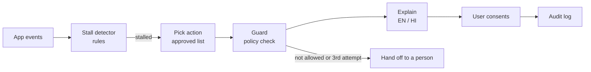

# Pakka ✦ — Hackathon Presentation Guide

**Team Queen** · Samina Parveen · Madhur Tandon · Aditya Karn
**Paytm Build for India AI Hackathon (Delhi)** · Track 2: AI-Powered Financial Journeys

> **One line:** Pakka spots when someone is stuck in a loan application, tells them what went wrong in their own language, and helps them fix it. If it can't, it hands them to a person.

```
spot it  →  explain it  →  fix it (with consent)  →  check it worked  →  hand off to a person if not
```

---

## 1. The problem

- Digital loan journeys lose people at small, fixable steps: a blurry Aadhaar photo, the wrong file type, a face check that fails in bad light, no DigiLocker account, or loan terms (APR, foreclosure, penal charges) the user doesn't understand.
- Today the app usually just says **"Try again."** A first-time borrower can read that as a **no** and give up.
- Hindi-first and first-time users are hit hardest. The Key Fact Statement (KFS) is full of jargon, and the error messages don't say *what* went wrong.

**Our mission line:** *"No one should give up on a loan over a blurry photo."*

## 2. Our solution: Pakka

Pakka is a **proactive rescue agent** that sits inside the loan journey:

1. **Spot it.** It watches app events and notices a stall without the user asking.
2. **Explain it.** It says what went wrong in **English or Hindi**, in writing or **out loud** (Sarvam Bulbul TTS).
3. **Fix it, with consent.** It offers a fix from a fixed **approved list**: guided photo retake, file conversion, video KYC, DigiLocker help, KFS explainer, resume link, callback.
4. **Hand off.** On the third attempt, or if an action isn't allowed, a **person takes over** and sees the full history, so the user doesn't have to repeat anything.
5. **Audit.** Every intervention is written to an audit log.

### Who it helps (illustrative personas)

| Situation | What Pakka does |
|---|---|
| First-time borrower: "My Aadhaar photo failed twice. The app just said try again." | Says what went wrong (corner cut off, blur, glare) and guides a retake |
| Hindi-first applicant: "APR, foreclosure, penal charges. I don't know what I'm agreeing to." | Explains all 6 KFS terms in Hindi |
| Shop owner on a busy day: "A customer walked in and I lost my place." | After 10 minutes idle, sends a resume link |
| Stuck at the face check: "It keeps failing in my room's light." | Gives tips first, then offers video KYC |
| Not on DigiLocker: "I've never used it. Now I can't get past this step." | Helps set it up, or switches to video KYC |

### Why it isn't "just a chatbot"

| | Typical chatbot | Pakka |
|---|---|---|
| Who starts it | The user has to ask | Pakka steps in on its own when it sees a stall |
| Who decides the action | A language model | **Rules**, then a **policy guard** against an approved list |
| What the user hears | Generated text, which can be made up | **Reviewed templates**, so nothing is made up |
| Loan decisions | Unclear | **Never.** None of the 9 actions approve or reject a loan |
| Dead ends | Can loop forever | Third attempt → a person |

**Design principle:** the language model is deliberately kept **out of the decision**. Rules pick the action, the guard checks it, and only then is the explanation written.

---

## 3. Architecture




### Tech stack

| Layer | Tech |
|---|---|
| API / server | **FastAPI** + Uvicorn (Python 3.11) |
| Agent orchestration | **LangGraph** state graph |
| Data models | **Pydantic v2** |
| Photo quality check | **OpenCV** + NumPy |
| Voice | **Sarvam AI Bulbul** text-to-speech (falls back to browser speech) |
| Storage / audit | **SQLite** (Postgres planned) |
| Frontend | Plain HTML/CSS/JS: landing page and live demo page |
| Quality | **pytest** (25 tests), eval scripts, **GitHub Actions CI**, **Docker** |

### Repository map

```
pakka/
  models.py      Event / Detection / Rescue data models
  detector.py    Rule-based stall detector (6 blockers)
  policy.json    Approved actions per blocker + consent flags
  policy.py      choose() / check() guard / needs_consent()
  agent.py       LangGraph agent: detect → decide → guard → explain
  explain.py     EN + HI templates, photo reasons, 6 KFS terms
  doccheck.py    OpenCV blur / glare / cut-off-card check
  pii.py         Masks Aadhaar, PAN, phone, email
  sarvam.py      Sarvam Bulbul TTS client (masks PII first)
  store.py       SQLite event store + audit log
  synth.py       Synthetic journey generator
app/
  main.py        FastAPI endpoints
  static/index.html  Landing page (mission, how it works, FAQ, help)
  static/demo.html   Live demo loan journey + guided tour
eval/
  run_eval.py    Main evaluation (500 journeys, 30 scenarios)
  holdout.py     Held-out test (260 journeys, 13 unseen patterns)
  make_scenarios.py  Builds the 30 scripted scenarios
tests/           25 pytest tests
Dockerfile, .github/workflows/ci.yml
```

---

## 4. How each piece works

### 4.1 Events: the input ([pakka/models.py](pakka/models.py))

Every tap in the loan journey sends an event:

- **Steps:** `basic → kyc → offer → bank → review`
- **Event types:** `step_view`, `upload_ok`, `upload_failed`, `liveness_failed`, `digilocker_error`, `kfs_open`, `back`, `session_expired`, `submit`
- Each event has a timestamp and an optional error code (`IMG_CROPPED`, `IMG_BLUR`, `IMG_GLARE`, `FILE_FORMAT`, `NOT_REGISTERED`, …).

### 4.2 Stall detector ([pakka/detector.py](pakka/detector.py))

The detector is rule-based and explainable: every detection comes with the **reasons** it was chosen.

| Blocker | Rule |
|---|---|
| `timeout` | Session expired, or **10 minutes** (600s) with no progress on any step |
| `bad_photo` | At KYC: **2+ failed uploads** since the last success, or 1 failure plus **90s idle** |
| `wrong_format` | Same as above, but the most common error code is `FILE_FORMAT` |
| `liveness` | **2+ failed face checks** at KYC |
| `digilocker` | DigiLocker error `NOT_REGISTERED` |
| `offer_jargon` | On the offer screen: opened the KFS and then **90s idle**, or pressed **back twice** |

Details that matter:
- A `submit` event means no stall.
- Failures are only counted **after the last successful upload**. One failure followed by a success is not a stall, so there are no false alarms for people who fix it themselves.

### 4.3 Approved-action policy ([pakka/policy.json](pakka/policy.json), [pakka/policy.py](pakka/policy.py))

The agent can **only** pick from this list. Each new attempt moves one step down the list:

| Blocker | Attempt 1 → 2 → 3 … |
|---|---|
| bad_photo | guided_recapture → human_handoff |
| wrong_format | convert_file → guided_recapture → human_handoff |
| liveness | retry_liveness_tips → switch_to_video_kyc → human_handoff |
| digilocker | digilocker_setup_help → switch_to_video_kyc → human_handoff |
| offer_jargon | explain_kfs → schedule_callback → human_handoff |
| timeout | send_resume_link → schedule_callback |

- **9 actions in total.** Each has a `needs_consent` flag. Retakes, file conversion, video KYC, callbacks and handoff need a **"yes"** from the user. Tips, the KFS explainer and the resume link don't.
- `max_attempts_before_handoff = 3`: after 3 attempts the case always goes to a person (if handoff is allowed for that blocker).
- `check()` raises a `PolicyViolation` if an action isn't approved for that blocker.

### 4.4 The LangGraph agent ([pakka/agent.py](pakka/agent.py))

The agent is a 4-node state graph:

```
detect ──(not stalled)──► END
   │
   └─(stalled)─► decide ─► guard ─► explain ─► END
```

- **detect:** runs the rule detector
- **decide:** `policy.choose(blocker, attempts)`
- **guard:** `policy.check()`. If it fails, the action is **overridden to `human_handoff`** and marked escalated.
- **explain:** fills in the template in the chosen language

It returns a `Rescue` object with the detection, action, message, `needs_consent`, `escalated`, `policy_ok` and `latency_ms`. It takes **about 1 ms** and makes no network calls.

### 4.5 Explanations in English and Hindi ([pakka/explain.py](pakka/explain.py))

- Every action has a reviewed **English and Hindi** template.
- Photo failures say the specific reason: *"a corner of the card was cut off"* / *"कार्ड का एक कोना कट जाने"*.
- The **KFS explainer** covers 6 terms in both languages: **APR, EMI, processing fee, cooling-off period, penal charges, foreclosure**.
- The resume link names the step where the application is saved.

### 4.6 Photo check with OpenCV ([pakka/doccheck.py](pakka/doccheck.py))

A real image-quality check that runs on any uploaded ID photo:

| Check | Method | Threshold |
|---|---|---|
| **Blur** | Variance of the Laplacian (sharpness) | < 60 → `IMG_BLUR` |
| **Glare** | Share of near-white pixels (≥250) | > 6% → `IMG_GLARE` |
| **Cut-off card** | Otsu threshold → morphological close → largest contour → does its bounding box touch the frame edge (2% margin)? | → `IMG_CROPPED` |
| **Not an image** | OpenCV can't decode it | → `FILE_FORMAT` |

The codes it returns are the same ones the detector and the explanation templates use, so the whole loop is connected.

### 4.7 Privacy and safety

- **PII masking** ([pakka/pii.py](pakka/pii.py)): Aadhaar numbers, PAN, Indian phone numbers and emails are replaced with `[AADHAAR]`, `[PAN]`, `[PHONE]`, `[EMAIL]` **before any text leaves the server** (for example, before it's sent to Sarvam for speech).
- **Consent:** nothing happens without a "yes" for any action marked `needs_consent`.
- **Audit log** ([pakka/store.py](pakka/store.py)): every intervention is stored with the journey, blocker, action, language, message, whether the policy check passed, and whether it was escalated. The attempt count per blocker is read from this log, which is what drives escalation.
- **No loan decisions:** Pakka only helps people finish the application.

### 4.8 Voice ([pakka/sarvam.py](pakka/sarvam.py))

- Calls the Sarvam `text-to-speech` API (`bulbul:v3`) with `en-IN` / `hi-IN`, after masking PII and capping the text at 1,500 characters.
- If `SARVAM_API_KEY` isn't set, `/speak` returns 503 and the demo page uses the **browser's speech synthesis** instead, so the demo always works.

### 4.9 API ([app/main.py](app/main.py))

| Method | Path | What it does |
|---|---|---|
| GET | `/`, `/demo` | Landing page, live demo |
| GET | `/health` | Health check, and whether Sarvam is enabled |
| POST | `/journeys` | Start a journey |
| POST | `/journeys/{id}/events` | Send an app event |
| GET | `/journeys/{id}/rescue?now=&lang=&dry=` | Run the agent. `dry=true` only checks; otherwise the attempt count is read from the audit log and the intervention is logged |
| GET | `/explain` | Render a template |
| POST | `/doccheck` | OpenCV photo check (8 MB limit) |
| GET | `/kfs/{term}?lang=` | Plain-language KFS term |
| POST | `/speak` | Sarvam TTS |
| GET | `/audit`, `/eval` | Audit log and evaluation results |

### 4.10 Frontend

- **Landing page** ([app/static/index.html](app/static/index.html)): the mission, headline stats, a scrolling "who it helps" reel, an interactive 7-step "how it works" walkthrough, an embedded guided tour, a "what brings you here?" help section (including a path for judges), FAQ, and "what it can and can't do".
- **Demo page** ([app/static/demo.html](app/static/demo.html)): a mock loan journey wired to the real API. It has failure buttons (corner cut off / blur / glare / wrong file / face check / DigiLocker), clock buttons to simulate idle time, real photo upload to `/doccheck`, an EN/हिंदी toggle, voice playback, a live audit table and eval results.
- **Guided tour** (`/demo?tour=1`): the **live app clicks through itself** with captions. It's not a recording.

---

## 5. Evaluation: tested, and honest about it

Run `python eval/run_eval.py`. **CI fails the build if any scenario or policy check fails.**

| What we checked | Result |
|---|---|
| Synthetic journeys (5 failure types × 80, plus 100 clean or near-miss) | 500 |
| Blocker detection accuracy | **1.00** |
| Agent actions checked against the approved list | **2,000, 0 violations** |
| Hand-written scenarios (expected blocker and action set by hand) | **30 / 30 passed** |
| KFS terms explained in English and Hindi | **6 / 6 in both** |
| Agent latency p50 / p95 (no network) | **~1.1 ms / ~1.8 ms** |

### Held-out test: journeys it was never tuned on

`python eval/holdout.py` builds **260 journeys from 13 new patterns** written *after* the detector. Examples: PAN upload succeeds and then Aadhaar fails, the user fixes the problem and moves on, a brief look at the KFS, a walk-away.

| | Result |
|---|---|
| Accuracy | **0.85** |
| False alarms on users who were fine | **0%** |
| Stuck users missed | 11% |

**The two misses are left visible on purpose, not tuned away:**
1. One failed face check followed by a long pause isn't flagged, because the liveness rule needs two failures.
2. Two failed uploads followed by a 10+ minute walk-away is labelled `timeout`, not `bad_photo`, so Pakka sends a resume link instead of a retake.

**What the numbers mean:** the 1.00 shows the rules do what we wrote, because the synthetic data comes from the same failure taxonomy. Real accuracy, and whether Pakka actually lifts completion, can only come from a **pilot against a control group**.

The handoff rate after 3 attempts is 0.8, not 1.0. That's by design: timeouts end in a callback offer, not a handoff.

### Tests

`pytest -q` runs **25 tests**: the detector rules, the policy guard, escalation, Hindi output, KFS coverage, PII masking, the OpenCV checks on generated card images (good, cropped, blurry, glare, not an image), and the full API flow.

### CI/CD

GitHub Actions runs `pytest`, `run_eval.py` and `holdout.py` on every push. The Docker image runs the eval at build time.

---

## 6. Live demo script (about 3 minutes)

```bash
pip install -r requirements.txt
python eval/run_eval.py
uvicorn app.main:app --reload     # http://localhost:8000
# or: docker build -t pakka . && docker run -p 8000:8000 pakka
```

1. **Landing page `/`.** Read the mission line. Point to the 4 stats: 9 approved actions, 0 violations, 0.85 held-out, about 1 ms.
2. **Open `/demo`** and go to the KYC step.
3. Press **"Corner cut off" twice.** Pakka pops up without being asked. Point out the chips: blocker, action, reasons, "policy ok", latency.
4. Switch to **हिंदी** and press **listen**: the same help in Hindi, read aloud.
5. Press **"Yes, help me"**. That's consent. A framing guide appears.
6. **Fail once more.** Pakka hands off to a person with the full history. Show the **audit log** table.
7. Upload a photo. **"Upload a real photo"** runs the OpenCV check on your own image.
8. Go to the **loan offer**, open the KFS and press the **+120s clock**. Pakka explains APR, EMI, fees, cooling-off and foreclosure.
9. Accept, then submit.

**Backup:** `/demo?tour=1` runs the whole story by itself with captions, which is handy if the Wi-Fi or your hands give out.

---

## 7. Likely judge questions

| Question | Answer |
|---|---|
| Where's the AI? | A LangGraph agent orchestrates detect → decide → guard → explain. OpenCV does computer vision on ID photos, and Sarvam's Indic speech model does voice. We deliberately keep generative AI out of the **decision** for safety and compliance. The roadmap adds an XGBoost + SHAP stall model trained on real event logs, with the rules kept as a fallback. |
| Why rules and not an ML model? | We have no real event logs yet. Rules are explainable, auditable and testable today. Once a pilot produces logs, we train XGBoost and use SHAP to explain each prediction. |
| Can it hallucinate? | No. What the user hears comes from reviewed templates, and actions are limited to an approved list checked by a guard node (0 violations in 2,000 checks). |
| Does it decide the loan? | No. None of the 9 actions approve or reject anything. |
| What about privacy? | PII is masked before text leaves the server, actions need consent, and every intervention is in the audit log. |
| Is the 1.00 accuracy real? | It shows the rules do what we wrote. The honest number is the held-out **0.85 with 0 false alarms**, and we show its two failure patterns. |
| Is it connected to Paytm? | No. It's a prototype on synthetic data only. |
| How would it scale? | It's a stateless FastAPI service with a sub-millisecond agent. Production would move to Postgres and a Redis event stream, with consent records stored. |

---

## 8. Roadmap

1. **Pilot** on one Paytm journey (personal-loan KYC, Hindi) against a **control group**, measuring completion lift.
2. **XGBoost + SHAP** stall model trained on real event logs, with the rules kept as a fallback.
3. **React Native widget** inside the Paytm app, a KFS explainer on the offer screen, and **more Indian languages** through Sarvam.
4. **Production infrastructure:** Postgres, a Redis event stream, and consent records.

## 9. Status at a glance

| Part | Status |
|---|---|
| Stall detector, policy and guard, LangGraph agent | ✅ Working |
| EN/HI explanations + 6 KFS terms | ✅ Working |
| OpenCV photo check | ✅ Working |
| PII masking, audit log | ✅ Working |
| FastAPI service, landing page, demo, guided tour | ✅ Working |
| Sarvam Bulbul voice | ✅ Wired up (needs `SARVAM_API_KEY`, falls back to browser voice) |
| XGBoost + SHAP model | 🔜 Planned for the pilot |
| In-app React Native widget | 🔜 Planned |

---

## 10. Second journey: Pakka for Merchants (`/merchant`)

**Problem:** shop owners repay merchant loans through **daily deductions from their sales (EDI)**. A slow day means a short deduction, and they often only find out after a charge or a credit-score hit.

**What Pakka does:** it reads the **lender's ledger** and flags a shortfall the same evening, or a sales dip before anything is overdue. It plays a **neutral Soundbox cue** (never amounts) and shows an app card with the lender's own figures in EN/HI. The merchant replies in Hindi, Hinglish or English, the reply is labelled as one of 9 fixed intents, and rules pick the response: a pay link to the lender, a reminder, a request **routed to the lender**, or a person.

**Why it's safe (9 guards, tested):** consent first, but a merchant's own distress reply always reaches a person (G1); the merchant's chosen hours, inside 08:00–19:00 (G2); one contact a day, and every other day during a shortfall (G3); no loan offers with dues or after stress (G4); Soundbox cue only (G5); lender scope (G6); third attempt to a person (G7); dispute or hardship to a person (G8); no decisions, ever (G9).

**Numbers:** 205 merchants × 30 days, 7,081 agent runs, **0 guard violations**, 41/41 distress replies handed to a person, ~1.2 ms p50. As with the loan journey, these show the rules work as designed on synthetic data. Real impact needs a pilot.

**Positioning: don't claim Paytm lacks proactive engagement.** Paytm's Q2 FY26 release already describes AI models that predict merchant churn and delinquency "enabling proactive engagement and collections efforts". Pitch the *how*, not the *whether*:

> "You already predict delinquency and engage proactively. Pakka is the layer that makes that engagement consented, private on a shared Soundbox, scripted by the lender, guarded against upsell and pressure, and auditable: the shape the January 2027 recovery rules and the May 2027 data-protection rules will require."

**Paytm figures for the deck.** These come from news reports of the 26 Oct Q2 FY27 release and from earlier releases. **Confirm them in the Q2 FY27 PDF on paytm.com's investor page before quoting.**
- Financial services distribution revenue up 49% YoY to ₹912 crore, driven by merchant loan distribution
- 1.64 crore merchants on subscription plans
- Repeat borrowers are more than half of merchant loan disbursements
- Default loss guarantee (DLG) costs expected to "increase materially" from Q3 FY27, after DLG arrangements resumed with the largest lending partner
- Merchant loans, Paytm's disclosed range (unchanged since at least Q4 FY25): Bucket-1 resolution 83–90%, recovery after 90+ DPD 30–35%, ECL 4.5–5.0%
- Wording: say ECL is "close to the 5% regulatory limit on loss guarantees", **not** "at the 5% cap"

| Likely question | Answer |
|---|---|
| "We already do proactive engagement." | "Yes, and Pakka doesn't replace your models. It's the response layer: consent first, a neutral Soundbox cue, lender-scripted messages, no upsell to stressed merchants, a person for hardship, and every step audited." |
| "How accurate is your AI?" | "On 50 blind Hindi replies written by a teammate who never saw the code: 78–82% for the language model alone. Our keywords were tuned on that set afterwards, so we don't quote their score as blind. What we optimise isn't accuracy but zero harmful nudges, and that's 0 with every model. A second blind set is the next step." |

**Pitch line (accurate as stated, don't strengthen it):**
> "On our blind Hindi test, one LLM on its own gave 5 distressed merchants a payment nudge. With our fail-safe on top, that's 0 for every model we tried. The safety doesn't depend on which model you pick: when unsure, Pakka routes to a person."

Don't name or criticise a provider on stage. 78% vs 82% is within the noise of a 50-reply test.

**Slide table:**

| Blind Hindi test (50 replies) | Accuracy | Distressed merchants nudged to pay |
|---|---|---|
| Keywords only (first version) | 44% | 4 |
| Language model alone | 78–82% | 0–5 |
| **Pakka: model + fail-safe** | 86–88%* | **0** |

\*Includes keywords tuned on this set; not a blind number.

**Demo (about 3 minutes, or `/merchant?tour=1`):**
1. `kirana_steady`: run 5 days. Nothing happens, so no false alarms.
2. `chai_seasonal`: consent screen → Allow → day 10 → Soundbox cue and app card → reply "Kal de dunga" → reminder at 08:00 plus a pay link → Next day → cured, thank-you, no offer.
3. `general_late_night`: clock 21:30, day 6 → `G2_hours deferred to 08:00` in the audit.
4. `tailor_stress`: day 15 → reply "Bimar tha, dukaan band thi" → handoff with the grievance officer → "View loan offers" is greyed out (`G4_no_upsell`).
5. Lender view: routed requests `pending lender decision`, the audit log, and **Guard violations = 0**.

---

### Closing line

> *A failed upload isn't a no.* Pakka makes sure every stuck user reaches either a fix or a person.
