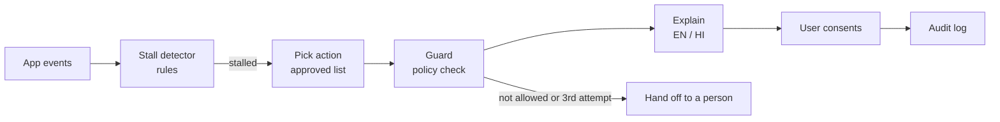

# Pakka ✦

**Team Queen** · Paytm Build for India AI Hackathon (Delhi) · Track 2: AI-Powered Financial Journeys

Pakka spots when someone is stuck in a loan application, tells them what went wrong in their own language, and helps them fix it. This repo is the working prototype of that rescue loop. It runs on synthetic data only and is not connected to Paytm.

```
spot it  →  explain it  →  fix it (with consent)  →  check it worked  →  hand off to a person if not
```

## What's in here

| Part | File | Status |
|---|---|---|
| Rule-based stall detector (2+ failed uploads, 90s idle, KYC error codes, offer hesitation, timeouts) | `pakka/detector.py` | Working |
| Approved-action policy: the agent can only pick from this list | `pakka/policy.json`, `pakka/policy.py` | Working |
| LangGraph agent: detect → decide → guard → explain | `pakka/agent.py` | Working |
| Explanations in English and Hindi, including six Key Fact Statement terms | `pakka/explain.py` | Working |
| Photo check with OpenCV (blur, glare, cut-off card) | `pakka/doccheck.py` | Working |
| PII masking before anything leaves the server | `pakka/pii.py` | Working |
| Audit log of every intervention (SQLite here, Postgres planned) | `pakka/store.py` | Working |
| FastAPI service and a demo loan journey page | `app/` | Working |
| Sarvam Bulbul voice | `pakka/sarvam.py` | Wired up, needs `SARVAM_API_KEY`; the page falls back to browser speech without it |
| XGBoost + SHAP stall model | | Planned for the pilot, once real event logs exist |
| React Native widget inside the Paytm app | | Planned |

The language model is deliberately kept out of the decision. Rules pick the action, the guard checks it against the approved list, and only then is the explanation written. In this prototype the explanations come from reviewed templates, so nothing a user hears is made up.



## System design


## Screenshots

The landing page explains the problem, who it helps and how it works, and plays a guided tour of the live app.

| Landing page | How it works |
|---|---|
|  |  |

Two failed Aadhaar uploads at KYC. Pakka explains what went wrong and offers a guided retake, in English or Hindi.

| Rescue (English) | Rescue (Hindi) |
|---|---|
|  |  |

The user accepts and gets a framing guide. One more failure and Pakka hands them to a person, and the audit log records each step.

| Guided retake | Handoff to a person |
|---|---|
|  |  |

On the loan offer, Pakka explains the Key Fact Statement terms when the user hesitates. The sidebar's Home tab shows where the application stands.

| Key Fact Statement explained | Home tab |
|---|---|
|  |  |

<details>
<summary>More screenshots: the rest of the landing page, and on a phone</summary>

| Mission | Who it helps |
|---|---|
|  |  |

| Guided tour playing | Help |
|---|---|
|  |  |

| What it can and can't do |
|---|
|  |

| Phone: landing | Phone: how it works | Phone: demo |
|---|---|---|
|  |  |  |

</details>

## Run it

```bash
pip install -r requirements.txt
python eval/run_eval.py          # builds eval/results.json
python eval/merchant_eval.py     # builds eval/merchant_results.json
uvicorn app.main:app --reload    # open http://localhost:8000
```

Or with Docker: `docker build -t pakka . && docker run -p 8000:8000 pakka`

To put it online, see [DEPLOY.md](DEPLOY.md): one-click Render Blueprint (`render.yaml`) or Vercel (`vercel.json`).

The landing page is at `/`, the loan-journey demo at `/demo` and the merchant demo at `/merchant`. Add `?tour=1` to watch the demo click through itself with captions.

To try it, open `/demo` and go to the KYC step. Choose a sample file (**Good photo**, **Corner cut off**, **Blurry**, **Glare** or **Wrong file**) or **Your own photo…**. A preview shows the file before anything is sent, and **Submit this document** runs the real OpenCV check on it. Submit a bad sample twice and Pakka pops up with a fix in English or Hindi. Accept it, fail once more, and it hands you to a person. The samples are drawn by `pakka/samples.py` (served at `/samples/{kind}`) and are marked "SAMPLE · DEMO ONLY". Use the clock buttons to test timeouts and the loan offer screen.

For real Bulbul voice, copy `.env.example` to `.env` and set `SARVAM_API_KEY`.

## Evaluation

`python eval/run_eval.py` runs everything below and fails if any scripted scenario or policy check fails. CI runs it on every push.

| What we checked | Result |
|---|---|
| Synthetic journeys (5 failure types + 100 clean or near-miss) | 500 |
| Blocker detection accuracy | 1.00 |
| Agent actions checked against the approved list | 2,000, **0 violations** |
| Hand-written scenarios (expected blocker and action written by hand) | 30 / 30 passed |
| KFS terms explained, English and Hindi | 6 / 6 in both |
| Agent latency, p50 / p95 (no network) | ~1.1 ms / ~1.8 ms |

### Loan document steps (reported separately)

`python eval/docs_scenarios.py` runs 25 hand-written scenarios for the document steps (PAN, Aadhaar OTP, selfie, bank account, auto-pay, income documents): **25 / 25**. They are reported on their own and are **not** part of the 30/30 or the 0.85 held-out score. Like the 30/30, they were written alongside the rules, so they check the logic, not real-world accuracy.

### Held-out test

`python eval/holdout.py` builds 260 journeys from 13 patterns written after the detector, which it was never tuned on: a PAN upload that works followed by Aadhaar failures, failures right at the 90-second line, someone fixing the problem and moving on, a brief look at the KFS, and so on.

| | Result |
|---|---|
| Accuracy | 0.85 |
| False alarms on users who were fine | 0% |
| Stuck users missed | 11% |

Two patterns fail, and we're leaving them visible rather than tuning the rules to pass:
1. One failed face check and then a long pause isn't flagged. The liveness rule needs two failures.
2. Two failed uploads and then a 10+ minute walk-away is labelled `timeout`, not `bad_photo`, so Pakka sends a resume link instead of a photo retake.

Please read the detection number carefully. The synthetic journeys are generated from the same failure taxonomy the detector uses, so 1.00 shows the rules do what we wrote, not how they'd do on real Paytm traffic. Near-miss journeys (one failed upload that then succeeds, a short pause on the offer screen) are included to check for false alarms. Real accuracy, and whether Pakka actually lifts completion, can only come from a pilot against a control group.

The handoff rate after three attempts is 0.8 rather than 1.0 because timeouts end in a callback offer, not a handoff.

## Tests

```bash
pytest -q
```

274 tests. 145 cover the loan journey: the detector rules, the policy guard, escalation, Hindi output, KFS coverage, PII masking, the OpenCV checks on generated card images, the full API flow, the document steps (format checks, each new blocker and ladder, the guard, "never says rejected", the Aadhaar number never stored in full), the Aadhaar photo reader, and the income-document check. 129 cover Pakka for Merchants: ledger modes and SMA boundaries, rules R1–R4, every guard G1–G9, intents in Hindi, Hinglish and English, the LLM fallbacks, PII masking before the LLM, templates, the API flows, the review fixes (distress without consent, cadence, pay choice, merchant hours, sensitive occasions), and the fail-safe intent rules, including the four blind-v1 replies as regression tests, and all three LLM providers (Anthropic, Gemini, Sarvam) with mocked clients.

## API

| Method | Path | What it does |
|---|---|---|
| POST | `/journeys` | Start a journey |
| POST | `/journeys/{id}/events` | Send an app event (`step_view`, `upload_failed`, `kfs_open`, …) |
| GET | `/journeys/{id}/rescue?now=&lang=` | Run the agent; logs the intervention. Add `dry=true` to check without logging |
| POST | `/doccheck` | Check an uploaded ID photo: quality, then read the Aadhaar card (masked) |
| POST | `/idcheck` | Offline PAN, Aadhaar or IFSC format check (`{"kind": "pan", "value": "..."}`) |
| POST | `/idcheck/names` | Name match across PAN, Aadhaar and bank account |
| POST | `/pdfcheck?months=3` | Check a bank statement or salary-slip PDF |
| GET | `/samples/{kind}` | Synthetic sample ID photos and statements for the demo |
| GET | `/kfs/{term}?lang=` | Plain-language KFS term |
| POST | `/speak` | Sarvam text-to-speech (needs a key) |
| GET | `/audit`, `/eval`, `/eval/docs` | Audit log, evaluation results, document-step scenarios |

## Loan document steps (Journey A)

The loan demo walks through the document steps of a Paytm-style application: **details → PAN → Aadhaar e-KYC → selfie → bank account → auto-pay (e-mandate) → loan offer (KFS) → review**. Pakka can step in at each one, with the same design as before: rules detect → `policy.json` chooses (ordered, 3rd attempt → a person) → guard → reviewed EN+HI templates → consent where needed → audit log.

- **Documents checklist:** pick pre-approved, salaried or self-employed to see the documents needed, each with a status and a one-line reason. Based on Paytm's public loan pages; exact documents depend on the lender.
- **Offline format checks** (`pakka/idcheck.py`): PAN (`ABCDE1234F` shape), Aadhaar (12 digits, not starting with 0/1, Verhoeff check digit; only `XXXX XXXX 1234` is ever shown or kept), IFSC, and a lenient name match across PAN, Aadhaar and the bank account.
- **Real Aadhaar photo check** (`pakka/aadhaar.py`, optional OCR): finds the number, validates its check digit and the front-side fields; blurs your own photo in the preview and replaces it with a masked copy after the check.
- **Income documents** (`pakka/pdfcheck.py`, `pypdf`): bank statements and salary slips as PDFs: won't open, password-protected, no readable dates, older than 45 days, or fewer months than asked.

| Blocker | Fires when | Pakka's help, in order |
|---|---|---|
| `pan_problem` | PAN typed wrong twice, PAN not linked to Aadhaar, or PAN/Aadhaar names differ | explain → PAN–Aadhaar link guide (not linked only) → person; a name mismatch is explained once, then a person |
| `aadhaar_otp` | OTP not received twice, or mobile not linked to Aadhaar | OTP tips → DigiLocker → offline Aadhaar file → person; mobile not linked → video KYC → person |
| `face_match` | Selfie doesn't match the ID twice | selfie tips → guided retake → video KYC → person |
| `bank_verify` | Wrong IFSC twice, account in another name, or the ₹1 check failed | explain → re-enter details → another account → person |
| `mandate_failed` | Bank doesn't support the method, auto-pay OTP timed out twice, or no debit card | explain → another method (net banking / debit card / UPI AutoPay) → another bank → person |
| `income_doc` | A statement upload fails any of the checks above | explain → guided re-upload → person |

The new rules live in `pakka/docs_detector.py` and run **after** the unchanged existing rules; the existing face-check rule is reused on the selfie step. The guard also refuses any action that would approve, reject or change a loan, and no template says "rejected". These are format and document checks, not NSDL, UIDAI or bank verification, which the lender runs. New Hindi strings are marked `# HI: needs native review`.

## What's next

1. Pilot on one Paytm journey (personal-loan KYC, Hindi) with a control group
2. Train XGBoost on real event logs, keep the rules as a fallback
3. App widget, KFS explainer on the offer screen, more languages through Sarvam
4. Postgres, Redis event stream, and consent records in production

## Pakka for Merchants

The same rules-first engine (detect → decide → guard → explain → audit), applied to a second journey: shop owners repaying a merchant loan through **daily auto-deductions from their sales settlements (EDI)**. When a slow day means the deduction falls short, the merchant often only finds out after a penal charge or a credit-score hit. Pakka warns them early, safely, and in their own language, and routes any request to the lender, which makes every decision.

Open `/merchant`, or `/merchant?tour=1` for the guided tour.

**Background.** Paytm's merchant loans are booked by partner banks and NBFCs, and are repaid by daily deduction from settlements, with Paytm as the lending service provider. How a short day is handled (carry-forward, grace period, penal charge) is not public, so here it is **lender configuration** (`shortfall_mode`), not hardcoded behaviour. RBI's stressed-asset framework puts accounts 1–30 days past due in SMA-0, 31–60 in SMA-1 and 61–90 in SMA-2; the lender ledger reports the bucket and Pakka only displays it. These background facts came from public descriptions; check them against the current Paytm and RBI pages before you quote them.

### What Pakka may do, and what the lender decides

| Pakka may | Only the lender may |
|---|---|
| Spot a shortfall or a sales dip from the lender's ledger | Calculate dues, penal charges or interest |
| Send a neutral Soundbox cue and an app card, in EN/HI | Approve a lower deduction, a new date, a restructure or a waiver |
| Send a UPI pay link to the **lender's** account | Approve any new credit |
| Set a reminder or a callback inside contact hours | Decide anything about the loan |
| Route a request to the lender as `pending_lender_decision` | |
| Hand off to a person, with the grievance officer | |

### Design rules (enforced in code, tested, and re-checked by the eval)

| Guard | Rule |
|---|---|
| G1 | No contact without active, versioned consent; offers need their own consent. A merchant's own dispute or hardship reply always reaches a person, even without consent |
| G2 | Proactive contact only inside the merchant's chosen hours (never wider than 08:00–19:00); otherwise deferred |
| G3 | At most one proactive contact a day, and during a shortfall only every other day unless the SMA bucket worsens |
| G4 | No new-credit offer while dues exist or within 90 days of a stress flag |
| G5 | The Soundbox plays only the neutral cue: no amounts, no "overdue", no loan words |
| G6 | Actions outside the lender's `allowed_actions` go to a person, with `policy_ok = false` |
| G7 | The third attempt in an episode goes to a person |
| G8 | Dispute, hardship (including bereavement, illness, weddings, flood and other calamities) or "already paid" stops the episode and goes to a person |
| G9 | Decision actions (approve, waive, reschedule now…) raise `PolicyViolation` |

The LLM never picks an action. It only labels the merchant's reply as one of nine fixed intents, after PII masking. Distress keywords always override it, and any unknown label becomes `unclear`. With no LLM configured (the default), an offline keyword classifier covering Hindi, Hinglish and English is used, so the demo needs no keys. Optional LLM providers, none required by the Docker image. Without `PAKKA_LLM_PROVIDER` the classifier stays on the offline keyword fail-safe.

**Switch on Sarvam:** `pip install sarvamai`, then put these two lines in `.env` (which is git-ignored):
```
PAKKA_LLM_PROVIDER=sarvam
SARVAM_API_KEY=your-key
```
It uses `sarvam-105b` in non-think mode with temperature 0. Override the model with `PAKKA_LLM_MODEL`. `eval/intent_holdout.py` reads `.env` itself; for the app, start it with `uvicorn app.main:app --env-file .env`.

Other providers:
- Anthropic: `pip install anthropic`, then set `PAKKA_LLM_PROVIDER=anthropic` and `PAKKA_LLM_API_KEY` (model defaults to `claude-haiku-5-5`).
- Gemini: `pip install google-genai`, then set `PAKKA_LLM_PROVIDER=gemini`, `PAKKA_LLM_API_KEY` and `PAKKA_LLM_MODEL` (temperature 0).

Both get PII-masked text and the same fixed label set. An unknown label becomes `unclear`; any error, including a 429, falls back to keywords. When combining, keyword `unclear` counts as an abstain, so the LLM decides; distress from either side wins; any other disagreement goes to a person. `eval/intent_holdout.py` spaces calls 4.5 s apart for Gemini (`PAKKA_LLM_PAUSE`), to stay under the free-tier rate limit.

**Blind intent check:** `python eval/intent_holdout.py` scores the classifier on `eval/intent_holdout.json`, which should be about 50 replies written by a teammate who hasn't seen the keyword lists. It scores the LLM too if one is configured. It is not a CI gate; report the numbers it gives.

**Principle: when unsure, Pakka routes to a person, never to a payment nudge.** A reply becomes `will_pay_*` only with a time word, a payment verb and no negation. Negation plus a money or sales word is hardship. Anything else is `unclear`, which goes to a person. With the LLM on, distress from either side wins, keyword `unclear` is an abstain (the LLM decides), and any other disagreement goes to a person.

| Blind set v1: 50 Devanagari replies by a teammate | **Distress replies given an automated payment message** | Accuracy | Distress reaching a person |
|---|---|---|---|
| **Blind, keywords as written before anyone saw the set** | **4** | **22 / 50 (44%)** | 17 / 21 |
| After the fail-safe fix (no longer blind; the 4 are now regression tests) | **0** | 44 / 50 (88%) | 21 / 21 |
| Sarvam `sarvam-105b` alone (blind) | **5** | 39 / 50 (78%) | 16 / 21 |
| Sarvam + keywords combined | **0** | 43 / 50 (86%) | 21 / 21 |
| Gemini `gemini-3.5-flash-lite` alone (blind) | **0** | 41 / 50 (82%) | 21 / 21 |
| Gemini + keywords combined | **0** | 44 / 50 (88%) | 21 / 21 |

The blind run exposed four general gaps. There were no financial-distress words ("बिक्री नहीं", "नुकसान", "हालात"). A bare time word ("अभी", "कल") counted as a promise to pay even in "अभी मीटिंग में हूं"; a payment word is now also required, and otherwise the reply goes to a person. There were spelling variants (फोन / फ़ोन). And "दुकान बंद" matched "before I close the shop". The LLM rows are blind: neither prompt contains anything from v1. Sarvam alone gave 5 distress replies a payment nudge ("अभी खाते में पैसे ही नहीं हैं" → will_pay_later). The keyword fail-safe caught all five in the combined pipeline, which is why the combined rule requires every `will_pay_*` label to pass it. Only the 44% is a blind number for the keywords. A second blind set (`python eval/intent_holdout.py eval/intent_holdout_v2.json`), with romanised Hindi, typos, mixed signals and lower-deduction or reschedule requests, is the honest next measurement.

| Part | File |
|---|---|
| Models (money in integer paise) | `pakka/merchant/models.py` |
| Lender ledger simulator: FIFO carry-forward or prepayment credit, DPD, SMA | `pakka/merchant/ledger.py` |
| Rules R1 shortfall, R2 arrears ageing, R3 sales-dip early warning, R4 cured | `pakka/merchant/rules.py` |
| Intent → action policy | `pakka/merchant/policy.json` |
| Guards G1–G9 | `pakka/merchant/guard.py` |
| Intent classifier (keywords, optional LLM) | `pakka/merchant/intents.py` |
| Reviewed EN/HI templates | `pakka/merchant/templates.py` |
| LangGraph agent: day-end, reply and offer paths | `pakka/merchant/agent.py` |
| Consent, episodes, lender requests, `merchant_audit` | `pakka/merchant/store.py` |
| Five personas + 200 random merchants | `pakka/merchant/synth.py` |
| API under `/merchant/...` | `app/merchant_api.py` |
| Consent screen, Soundbox mock, app card, lender view, tour | `app/static/merchant.html` |

### Demo personas

| Persona | What happens |
|---|---|
| `kirana_steady` | Sales always cover the EDI. No contact, ever. Offers allowed |
| `chai_seasonal` | Rain on day 10: Soundbox cue and app card. "Kal de dunga" sets a reminder (moved to 08:00 because 20:00 is outside contact hours) and a pay link. Day 11: cured, thank-you, no offer |
| (any) | "Abhi pay karta hoon" with arrears offers two UPI links: just today's shortfall, or the total due |
| `tailor_stress` | Early warning (R3) on day 14, shortfall on day 15. "Bimar tha, dukaan band thi" means hardship: handoff to a person, episode stopped, offers blocked (G4) |
| `mobile_dispute` | Demo Bank B holds partial deductions as prepayment, so day 8 shows ₹600 due despite a ₹400 deduction. "Maine already pay kiya" means a handoff. Asking for a lower deduction is outside this lender's scope (G6), so that goes to a person too |
| `general_late_night` | Shortfall detected at 21:30, deferred to 08:00 (G2) |

### Evaluation

`python eval/merchant_eval.py` runs the 5 personas and 200 random merchants for 30 days each, with random contact times, random consent, labelled replies and same-day reruns. It fails CI if any guard is violated, or if any distress reply isn't handed off.

| What we checked | Result |
|---|---|
| Agent runs (day-end, replies, offers) | 7,081 |
| Guard violations (Soundbox text, merchant hours, daily cap, every-other-day cadence, upsell, lender scope, consent, decisions) | **0** |
| R1 against the lender ledger | precision 1.0, recall 1.0 |
| Hardship / dispute / already-paid replies handed to a person (including 4 from merchants who never consented) | 41 / 41 |
| Keyword intents on our own 31 labelled replies | 29 / 31 (two short replies with no payment word now go to a person) |
| Agent latency p50 / p95 (keyword path, no network) | ~1.2 ms / ~3.4 ms |

These numbers show the rules and guards behave as designed on synthetic data, nothing more. R1 is checked against the same ledger it reads, and the reply samples were written alongside the keyword lists. Real impact needs a pilot with a randomised holdout, measuring day-0 and day-7 cure rate, the SMA-0 → SMA-1 roll rate, Bucket-1 resolution, complaint rate, opt-out rate and promises to pay kept.

**Not built (on purpose, for now):** server-side speech-to-text (the page uses the browser's Web Speech API and posts text), penal-charge calculation, restructuring logic, outbound calls, and any real Paytm or lender integration.

### Backup demo recording

If the live demo fails on stage, play a recording of the tour: open `/merchant?tour=1` in Chrome, press Win+Alt+R (Xbox Game Bar) or use any screen recorder, and let the 14 steps run (about 70 seconds). Record it the night before.

## Team

Samina Parveen · Madhur Tandon · Aditya Karn
